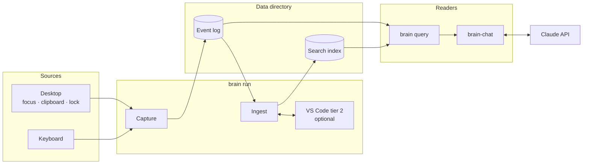
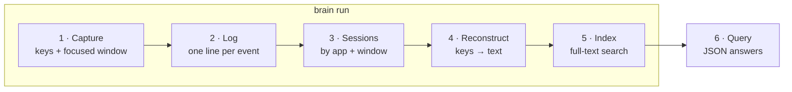

# brain — diagrams

## Components

`brain run` captures and indexes in the background; `brain query` and
brain-chat only read.

## Stages

What happens to what you type, from the keyboard to an answer.

| Stage | What it does |
|---|---|
| Capture | Reads the keyboard without delaying it, and asks the desktop which window has focus. |
| Log | Appends every event to `events.jsonl`, the ground truth. |
| Sessions | Groups typing per app and window; a session ends after 30 s idle or on Enter in a single-line field. |
| Reconstruct | Replays the keys into the text the app shows (Backspace, selections, undo); VS Code can use the real editor. |
| Index | Stores each session's text in SQLite with substring search. |
| Query | `brain query` searches sessions or rebuilds a time range; brain-chat asks Claude on top of it. |
