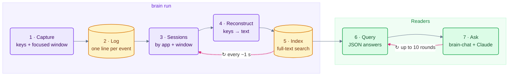

# brain — diagrams

## Components

`brain run` (purple) captures and indexes in the background into the data
directory (amber); the readers (green) only read. Thick pink arrows are
two-way.

```mermaid
%%{init: {"theme": "base", "themeVariables": {"fontSize": "15px", "lineColor": "#64748b", "edgeLabelBackground": "#ffffff"}, "flowchart": {"curve": "basis", "padding": 18, "nodeSpacing": 45, "rankSpacing": 60}}}%%
flowchart LR
    subgraph SRC["Sources"]
        KB(["Keyboard"])
        DE(["Desktop<br/>focus · clipboard · lock"])
    end

    CAP("brain run<br/><b>Capture</b>")
    LOG[("Event log")]
    ING("brain run<br/><b>Ingest</b> ↻ every ~1 s")
    T2("VS Code tier 2<br/>optional")
    DB[("Search index")]

    subgraph USE["Readers"]
        Q("brain query")
        CHAT("brain-chat")
    end

    API{{"Claude API"}}

    KB --> CAP
    DE <-->|"focus in · clipboard on paste"| CAP
    CAP -->|"append"| LOG
    LOG -->|"tail"| ING
    ING -->|"write"| DB
    ING <-->|"jobs · results"| T2
    DB --> Q
    LOG --> Q
    Q <-->|"calls · JSON"| CHAT
    CHAT <-->|"tool calls · answers"| API

    classDef src fill:#e0f2fe,stroke:#0284c7,stroke-width:1.5px,color:#0c4a6e
    classDef proc fill:#ede9fe,stroke:#7c3aed,stroke-width:1.5px,color:#3b0764
    classDef store fill:#fef3c7,stroke:#d97706,stroke-width:1.5px,color:#78350f
    classDef read fill:#dcfce7,stroke:#16a34a,stroke-width:1.5px,color:#14532d
    classDef ext fill:#f1f5f9,stroke:#475569,stroke-width:1.5px,color:#0f172a
    class KB,DE src
    class CAP,ING,T2 proc
    class LOG,DB store
    class Q,CHAT read
    class API ext

    style SRC fill:#f0f9ff,stroke:#bae6fd,color:#0369a1
    style USE fill:#f0fdf4,stroke:#bbf7d0,color:#15803d

    linkStyle 1,5,8,9 stroke:#db2777,stroke-width:3px
```

## Stages

What happens to what you type, from the keyboard to an answer. Dashed
arrows are loops.

| Stage | What it does |
|---|---|
| Capture | Reads the keyboard without delaying it, and asks the desktop which window has focus. |
| Log | Appends every event to `events.jsonl`, the ground truth. |
| Sessions | Groups typing per app and window; a session ends after 30 s idle or on Enter in a single-line field. |
| Reconstruct | Replays the keys into the text the app shows (Backspace, selections, undo); VS Code can use the real editor. |
| Index | Stores each session's text in SQLite with substring search. |
| Query | `brain query` searches sessions or rebuilds a time range, while `brain run` keeps writing. |
| Ask | brain-chat lets Claude call `brain query` until it can answer a plain-language question. |
