# brain — diagrams

The system's structure and its main flows, drawn from the code as built.
The diagrams are [Mermaid](https://mermaid.js.org/): GitHub renders them in
place.

1. [System design](#1-system-design)
2. [Data model](#2-data-model)
3. [Happy flows](#3-happy-flows)
   1. [Start and stop of `brain run`](#31-start-and-stop-of-brain-run)
   2. [A keystroke, from the keyboard to the log](#32-a-keystroke-from-the-keyboard-to-the-log)
   3. [A focus change](#33-a-focus-change)
   4. [A paste](#34-a-paste)
   5. [Ingest: from the log to searchable sessions](#35-ingest-from-the-log-to-searchable-sessions)
   6. [The life of a session](#36-the-life-of-a-session)
   7. [VS Code tier 2](#37-vs-code-tier-2)
   8. [`brain query search` and `brain query text`](#38-brain-query-search-and-brain-query-text)
   9. [A brain-chat question](#39-a-brain-chat-question)

## 1. System design

One process, `brain run`, captures and indexes; readers (`brain query`,
brain-chat) never write. The log is the ground truth; the database is
derived from it. The data directory is private (0700), and `run.lock`
lets only one `brain run` use it at a time.

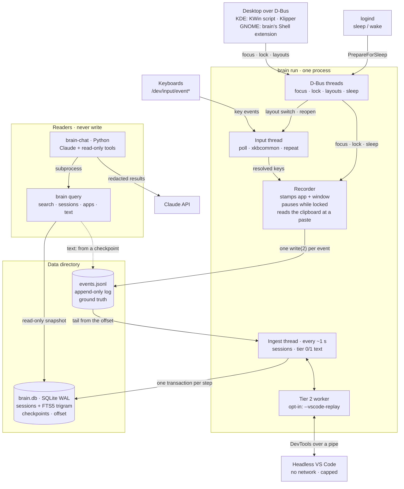

| Part | Code |
|---|---|
| Input thread | `src/capture/linux/input.rs`, `keys.rs`, `xkb.rs` |
| Desktop backends | `src/capture/linux/desktop.rs`, `kde.rs` + `kwin_focus.js`, `gnome.rs` + `packaging/gnome-extension/` |
| Recorder | `src/capture/recorder.rs` |
| Log | `src/eventlog.rs` |
| Ingest and sessions | `src/ingest.rs`, `src/sessions.rs`, `src/reconstruct/` |
| Tier 2 | `src/reconstruct/tier2.rs`, `src/reconstruct/vscode/` |
| Database | `src/store.rs` |
| Queries | `src/query.rs` |
| brain-chat | `chat/` |

## 2. Data model

`events.jsonl` holds one JSON object per event. Everything in `brain.db`
is derived from it and can be rebuilt by deleting the database (tier 2
text aside, which depends on files on disk).

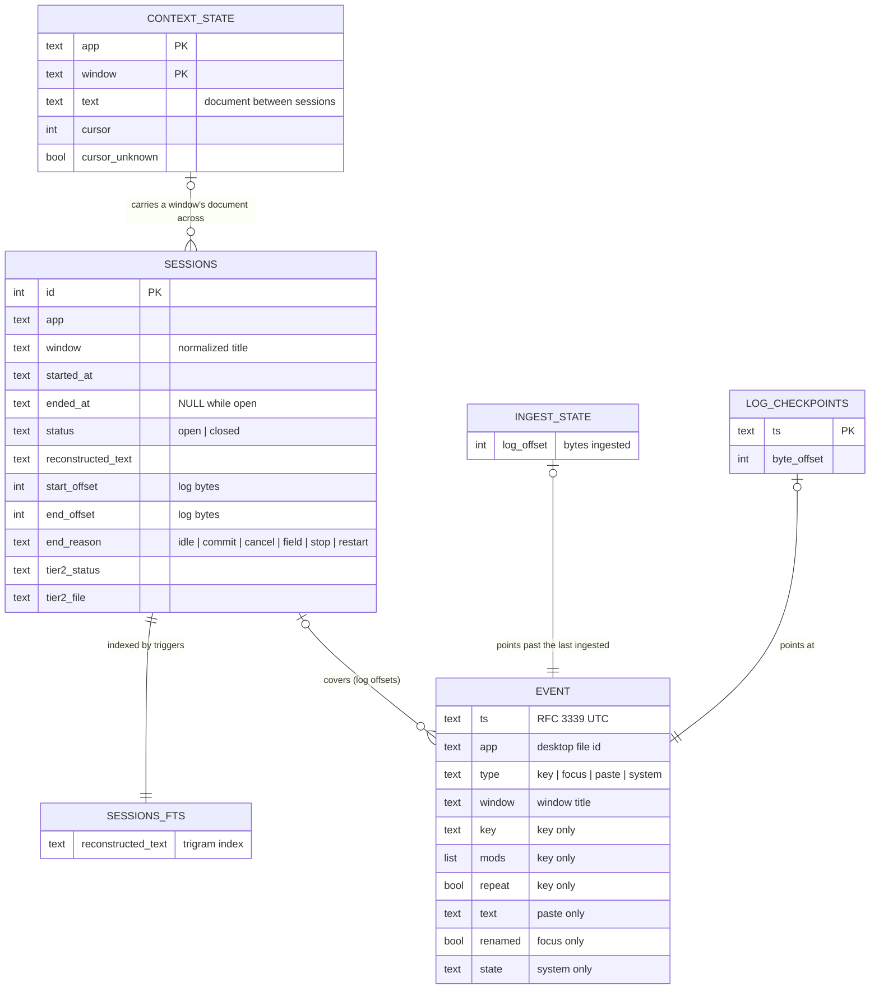

## 3. Happy flows

### 3.1 Start and stop of `brain run`

Everything that can fail is set up before capture starts. On a signal,
capture stops first, then a final ingest pass takes in every last event.

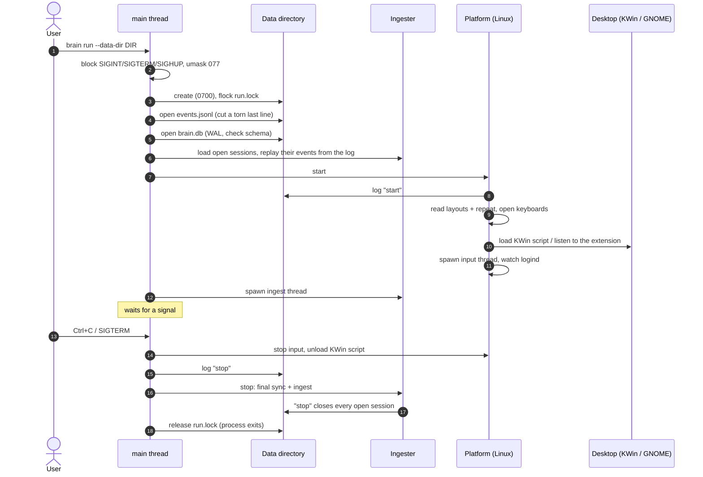

### 3.2 A keystroke, from the keyboard to the log

The input thread never touches SQLite: per key it does one read, one
xkbcommon lookup and one `write(2)`. A stalled brain cannot delay the key,
because the compositor reads the same device independently.

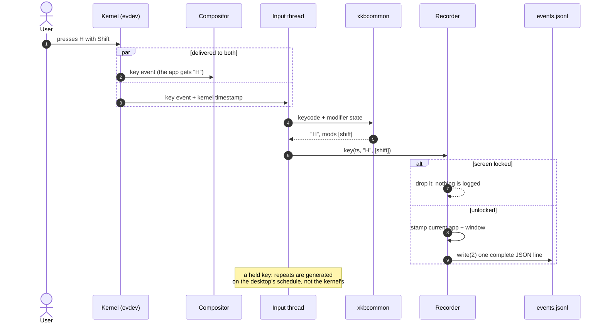

### 3.3 A focus change

The compositor is the only process that knows which window has focus, so
brain's code runs inside it and reports out. Reports from anyone else are
ignored.

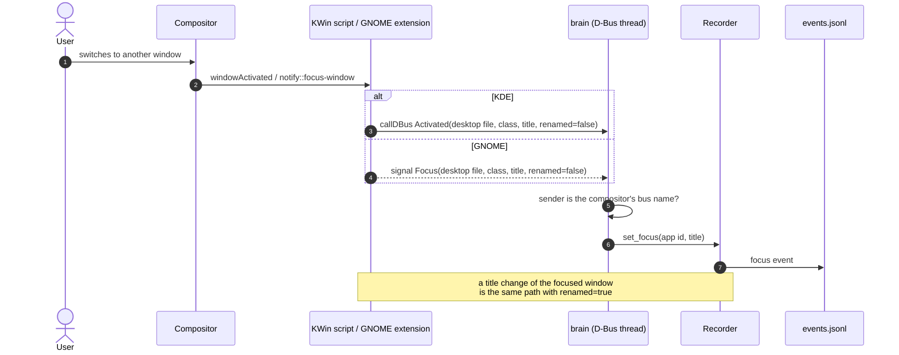

### 3.4 A paste

Only pastes are recorded, never copies. The clipboard is read outside the
log lock, with a 300 ms limit, because this runs on the input thread.

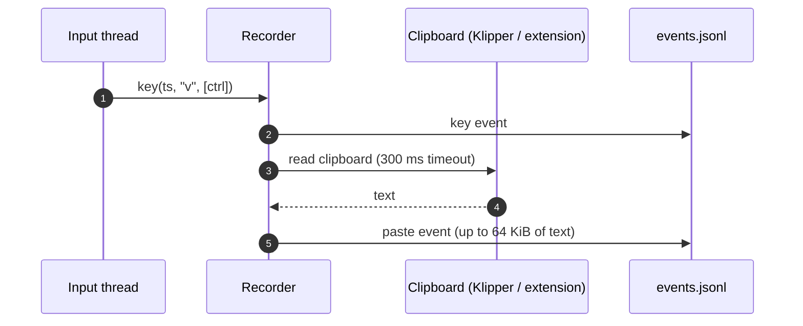

### 3.5 Ingest: from the log to searchable sessions

Each step is one SQLite transaction holding everything derived from a batch
of lines together with the new log offset, so a crash at any point neither
loses nor repeats an event.

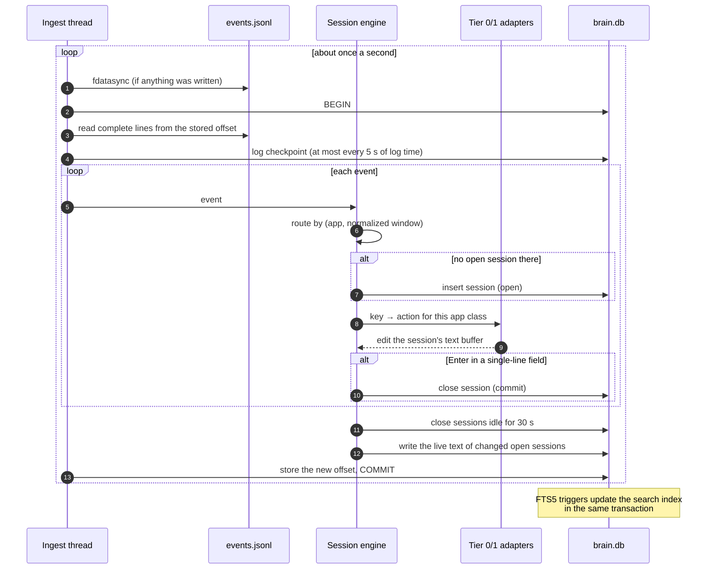

### 3.6 The life of a session

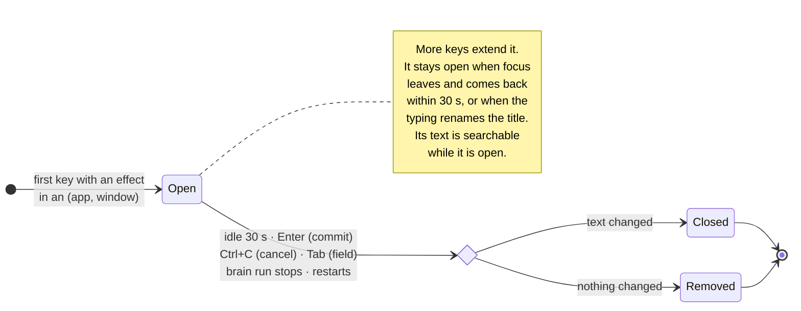

### 3.7 VS Code tier 2

Opt-in with `--vscode-replay`. A file saved after the session gives an
exact diff and VS Code is never started; otherwise the keys are replayed
into a sandboxed VS Code as a best effort. The tier 0/1 text stays if
neither works.

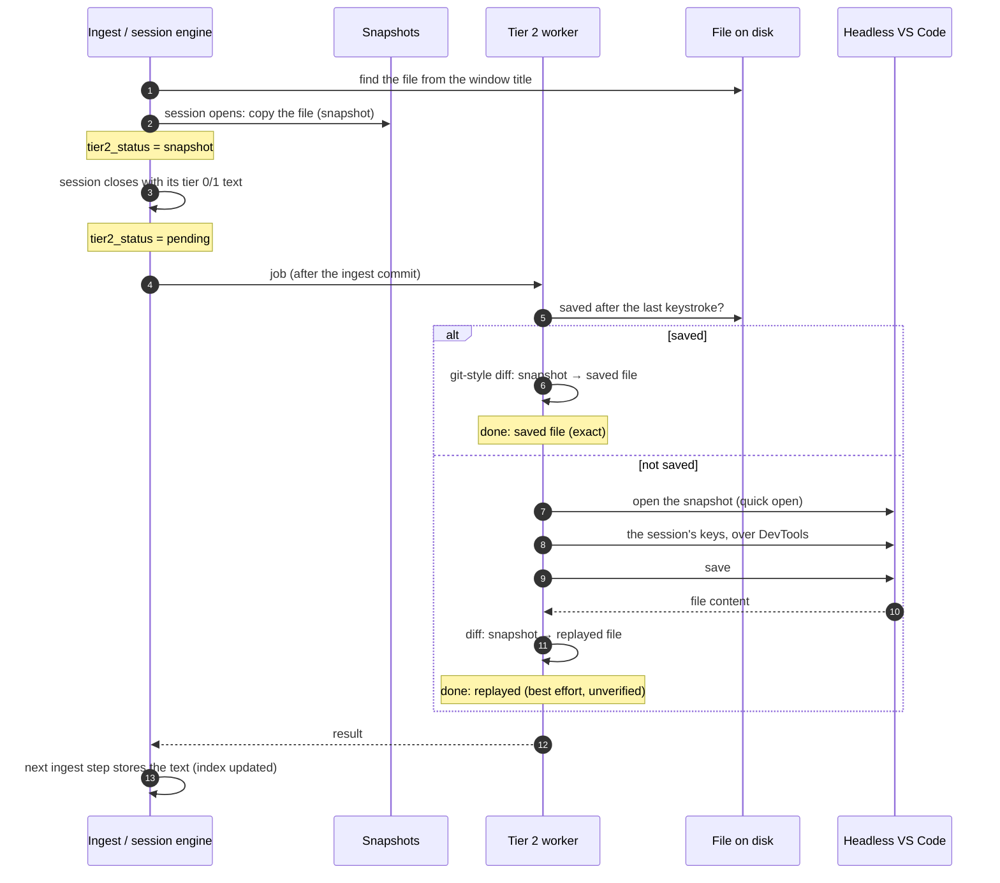

### 3.8 `brain query search` and `brain query text`

Both run while `brain run` writes. `search` reads a consistent snapshot of
the database; `text` reads the log itself and reconstructs it per window.

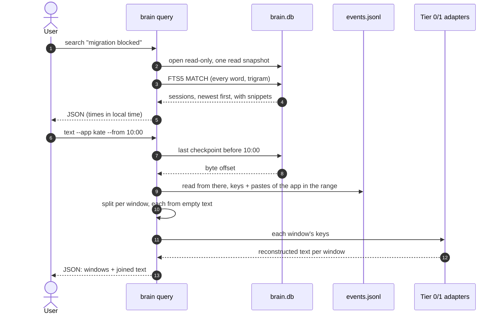

### 3.9 A brain-chat question

The loop runs locally. Claude decides which lookups to make and when it has
enough; every tool result is capped and redacted before it leaves the
machine.

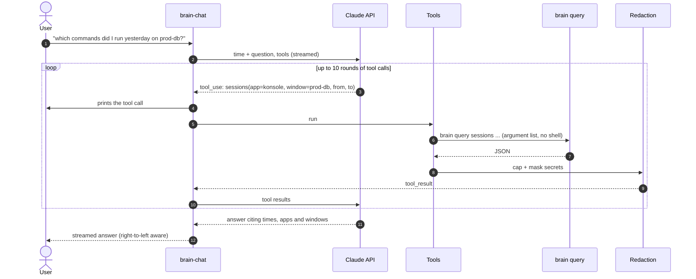
