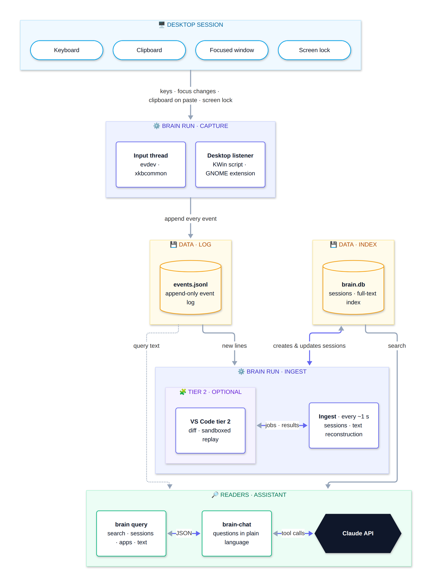
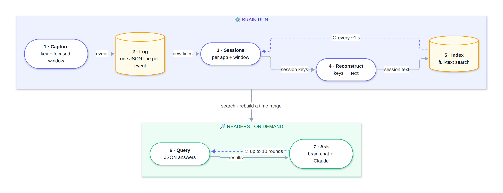

# brain — diagrams

## Architecture

Layers run top to bottom, in the order data flows through them. Capture
appends every event to `events.jsonl`; ingest reads the new lines and
creates and updates sessions in `brain.db`; `brain query` searches
`brain.db` and reads `events.jsonl` for `query text`. Indigo arrows are
two-way; the dotted arrow is `query text`.

| Layer | Role |
|---|---|
| Desktop session | What brain listens to: the keyboard, the focused window, the clipboard at a paste, the screen lock. |
| brain run · capture | Reads keys passively (never delaying them) and gets focus from inside the compositor. |
| Data · log / index | `events.jsonl`, the ground truth, appended once and never rewritten; `brain.db`, sessions and their full-text index, rebuildable from the log. |
| brain run · ingest | Every second, turns new log lines into sessions and reconstructs their text. |
| Tier 2 · optional | VS Code sessions from the real editor: a diff of the saved file, or a sandboxed replay. |
| Readers · assistant | `brain query` answers while `brain run` keeps writing; brain-chat lets Claude call it to answer plain-language questions. |

## Stages

What happens to what you type, from the keyboard to an answer. Dotted
arrows are loops.

| Stage | What it does |
|---|---|
| Capture | Reads the keyboard without delaying it, and asks the desktop which window has focus. |
| Log | Appends every event to `events.jsonl`, the ground truth. |
| Sessions | Groups typing per app and window; a session ends after 30 s idle or on Enter in a single-line field. |
| Reconstruct | Replays the keys into the text the app shows (Backspace, selections, undo); VS Code can use the real editor. |
| Index | Stores each session's text in SQLite with substring search. |
| Query | `brain query` searches sessions or rebuilds a time range, while `brain run` keeps writing. |
| Ask | brain-chat lets Claude call `brain query` until it can answer a plain-language question. |
